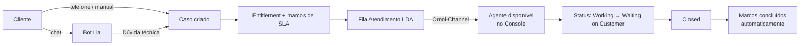

# 🚀 LDA Alimentos · Service Cloud
 

 
MVP de atendimento ao cliente construído no **Salesforce Service Cloud** para a LDA Alimentos, empresa fictícia de um case do programa de formação de consultores funcionais (Agogê) da Grupo Taak.
 
O projeto cobre todo o ciclo de vida de um caso: o cliente fala com um bot, o caso nasce com prazos de SLA, entra numa fila, é distribuído automaticamente para um agente disponível e, ao ser fechado, tem seus marcos concluídos sozinhos.
 
---
 
## Sumário
 
- [O case](#o-case)
- [Jornada do caso](#jornada-do-caso)
- [O que foi construído](#o-que-foi-construído)
- [Automações (Flows)](#automações-flows)
- [Melhorias pós Sprint Review](#melhorias-pós-sprint-review)
- [Decisões e aprendizados](#decisões-e-aprendizados)
- [Como testar](#como-testar)
- [Limitações e próximos passos](#limitações-e-próximos-passos)
- [Trilhas do Trailhead](#trilhas-do-trailhead)
---
 
## O case
 
A LDA Alimentos já usava o Salesforce no comercial e decidiu levar o atendimento para o Service Cloud. O desafio era entregar um **MVP de atendimento** a partir de user stories no formato EQPA (Eu, Quero, Para, Aceito), avaliado em três pontos: entendimento das stories, construção da solução e apresentação final (simulação de Sprint Review de 15 minutos).
 
| # | Story | Critérios de aceite |
|---|---|---|
| 1 | Horário Comercial | Segunda a sexta, das 8h às 18h |
| 2 | Marcos | Primeira resposta 1h · Tratativa 6h · Resposta do cliente 8h · Finalização 8h |
| 3 | Processo de habilitação | Tipo Caso, ativo, entra na criação, sai no fechamento, usa o horário comercial |
| 4 | Console de Atendimento | App chamado "Console de Atendimento", objetos de casos, logo da LDA, Omni-Channel |
| 5 | Bot Einstein | Ativar o bot e criar um com nome criativo |
| 6 | Diálogo Dúvidas Técnicas | Pergunta a dúvida e abre um caso via Flow |
| 7 | Diálogo Status do Caso | Pede o número e devolve o status do caso |
| 8 | Menu do bot | Dúvidas Técnicas · Status do caso · Transferir pro agente |
| 9 | Omni-Channel | Status Disponível / Ocupado / Em Pausa, máximo de 5 atendimentos, recursos para os agentes |
 
---
 
## Jornada do caso
 

 
---
 
## O que foi construído
 
### 1. SLA: horário comercial, marcos e processo de habilitação
 
**Business Hours:** `Horário LDA Alimentos`, fuso America/Sao_Paulo, segunda a sexta das 8h às 18h. Fora desse horário o relógio do SLA para.
 
**Status de caso:** criado o valor `Waiting on Customer` para representar a espera pelo retorno do cliente. O valor `Closed` foi habilitado na lista de status (Support Settings › *Show Closed Statuses in Case Status Field*).
 
**Entitlement Process:** `Processo LDA Alimentos` (versão 2), tipo Caso.
 
| Marco | Prazo | Critério |
|---|---|---|
| Primeira Resposta | 60 min | `Status = New` |
| Tratativa | 360 min | `Status = Working` |
| Resposta do Cliente | 480 min | `Status = Waiting on Customer` |
| Finalização do Chamado | 480 min | `Case Number ≠ vazio` (vale para todo caso) |
 
- Entrada no processo: data de criação do caso
- Saída do processo: quando o caso é fechado
**Entitlement:** `Suporte Padrão LDA`, ativo, ligado ao processo e ao horário comercial. Serve de Entitlement padrão para casos sem contrato próprio.
 
### 2. Console de Atendimento
 
Lightning App em **navegação console**, com:
- Logo da LDA Alimentos
- Abas: Cases, Accounts, Contacts, Entitlements, Reports, Dashboards
- Barra de utilitários: **Omni-Channel**, History e Macros
- Página de Caso com o componente **Milestones** (timer do marco atual e botão *Mark Completed*) e o campo Entitlement visível
### 3. Omni-Channel
 
| Item | Configuração |
|---|---|
| Service Channel | `Casos` (objeto Case) + canal Messaging |
| Routing Configuration | `Roteamento LDA`: prioridade 1, *Most Available*, 1 unidade por caso |
| Fila | `Atendimento LDA`: objetos Case e Messaging Session |
| Presence Statuses | `Disponível` (Online) · `Ocupado` (Busy) · `Em Pausa` (Busy) |
| Presence Configuration | `Presença LDA`: capacidade **5** atendimentos simultâneos |
| Acesso aos status | Permission set `Omni-Channel Agentes LDA` |
| Service Resource | Registro de recurso do tipo Agente para cada atendente |
 
O Omni entrega o caso para o agente **Disponível** com mais capacidade livre. Agentes Ocupados, Em Pausa ou com 5 casos abertos são pulados.
 
### 4. Bot Lia (Einstein Bot)
 
**Lia** vem de *LDA Inteligência de Atendimento*. Enhanced Bot em português, com o seguinte comportamento:
 
| Diálogo | O que faz |
|---|---|
| Welcome | Dá boas-vindas e abre o menu principal |
| Main Menu | "Como posso te ajudar?" + 3 opções |
| Dúvidas Técnicas | Pergunta a dúvida, chama um Flow que cria o caso e devolve o número |
| Status do caso | Pede o número, chama um Flow que busca o caso e devolve o status (ou "não encontrado") |
| Transferir para o agente | Transfere para a fila `Atendimento LDA` via Omni-Channel Flow |
| Confused | Responde "Desculpe, não entendi" e volta ao menu |
 
Ao fim de cada diálogo a Lia volta ao menu principal, então o cliente nunca fica sem opção.
 
---
 
## Automações (Flows)
 
| Flow | Tipo | O que faz |
|---|---|---|
| `Caso - Preencher Entitlement` | Record-Triggered (antes de salvar, na criação) | Usa o Entitlement ativo da conta. Se não houver, usa o `Suporte Padrão LDA`. Depois envia o caso para a fila `Atendimento LDA` |
| `Caso - Concluir Marcos ao Fechar` | Record-Triggered (depois de salvar, ao virar Closed) | Preenche a `CompletionDate` de todos os marcos ainda abertos do caso |
| `Bot - Criar Caso Duvida Tecnica` | Autolaunched | Cria um caso Tipo `Dúvida Técnica` com a descrição do cliente e devolve o número |
| `Bot - Consultar Status Caso` | Autolaunched | Busca o caso pelo número e devolve o status ou "não encontrado" |
| `Transferir para Atendimento LDA` | Omni-Channel Flow | Roteia a conversa do bot para a fila de atendimento |
| `Route to Lia` | Omni-Channel Flow | Leva a conversa do chat até o bot (gerado pelo assistente de criação do bot) |
 
---
 
## Melhorias pós Sprint Review
 
Depois da apresentação, três ajustes foram pedidos e implementados:
 
1. **Fila automática.** Antes, o caso ficava com quem o criava e precisava de *Change Owner* manual. Agora todo caso novo, manual ou criado pelo bot, vai direto para a fila e o Omni distribui sozinho.
2. **Entitlement em todos os casos.** Antes, só casos de contas com Entitlement próprio ganhavam SLA. Agora o Flow usa o `Suporte Padrão LDA` como garantia, inclusive para casos sem conta.
3. **Fechamento com marcos concluídos.** O status `Closed` passou a aparecer na lista, e ao fechar o caso todos os marcos abertos são concluídos automaticamente.
---
 
## Decisões e aprendizados
 
- **Marcos ativados por status.** Cada marco corresponde a uma etapa do atendimento, e o agente conclui o marco com *Mark Completed* antes de avançar o status.
- **Marco incompleto é removido quando seu critério deixa de valer.** Com o critério `Status ≠ Closed`, a Finalização sumia ao fechar o caso. A solução foi um critério que continua verdadeiro (`Case Number ≠ vazio`).
- **Processo ativado não pode ter os marcos editados**, nem depois de desativado. Foi preciso ligar o *Entitlement Versioning* e criar a versão 2 do processo.
- **Depois que o caso sai do processo, as datas dos marcos ficam travadas.** Por isso a conclusão automática roda no mesmo instante em que o caso é fechado.
- **Permission set em vez de perfil** para liberar os status de presença aos agentes, seguindo a recomendação atual da Salesforce.
- **Bot User dedicado.** Na org de treinamento o bot roda com o usuário da consultora. Em produção, o recomendado é um usuário próprio com permissões mínimas.
---
 
## Como testar
 
1. **Bot:** Einstein Bot Builder › Preview › `Oi` › `1` › digite uma dúvida › anote o número do caso › `2` › digite o número › confira o status
2. **Caso manual:** Console de Atendimento › Cases › New › Save
3. **SLA:** o caso nasce com Entitlement, Primeira Resposta (1h) e Finalização (8h). Fora do horário comercial, o prazo começa no próximo dia útil às 8h
4. **Omni-Channel:** com o agente **Disponível**, o caso toca no Omni sem ação manual › Accept
5. **Etapas:** Mark Completed na Primeira Resposta › Status `Working` (aparece Tratativa) › `Waiting on Customer` (aparece Resposta do Cliente)
6. **Fechamento:** Status `Closed` › Related › Case Milestones: todos os marcos ficam Completed, com data
---
 
## Limitações e próximos passos
 
- **Chat em produção:** a transferência do bot para o agente está configurada, mas no Preview ela é simulada. O teste ponta a ponta exige publicar o chat (Enhanced Chat) num site.
- **Agentforce:** a Salesforce colocou o Einstein Bots em modo de manutenção e recomenda o Agentforce para projetos novos. O bot foi feito em Einstein porque o case pedia; num projeto real, valeria avaliar a migração.
- **Entitlement por cliente:** o Entitlement padrão está ligado a uma conta de exemplo. O ideal é cada cliente ter o seu, ou mover o padrão para uma conta genérica de suporte.
- **Regra de fechamento:** hoje é possível fechar o caso a qualquer momento. Uma regra de validação poderia exigir os marcos concluídos antes.
- **Equipe:** para a distribuição entre vários agentes, cada usuário precisa estar na fila, ter Service Cloud User, a Presença LDA e o permission set de presença.
---
 
## Trilhas do Trailhead
 
- [Trilha Service Cloud](https://trailhead.salesforce.com/pt-BR/content/learn/trails/service_cloud_move)
- [Set Up Case Escalation and Entitlements](https://trailhead.salesforce.com/pt-BR/content/learn/projects/set-up-case-escalation-entitlements)
- [Omni-Channel](https://trailhead.salesforce.com/pt-BR/content/learn/modules/omni-channel-lex)
- [Service Bots Basics](https://trailhead.salesforce.com/pt-BR/content/learn/modules/service_bots_basics)
- [Service Cloud Specialist Trailmix](https://trailhead.salesforce.com/pt-BR/users/svccloud/trailmixes/service-cloud-specialist-trailmix)
---
 
Desenvolvido por **Maria Eduarda Cortellini** durante o estágio em consultoria Salesforce.
 
