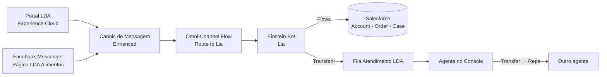
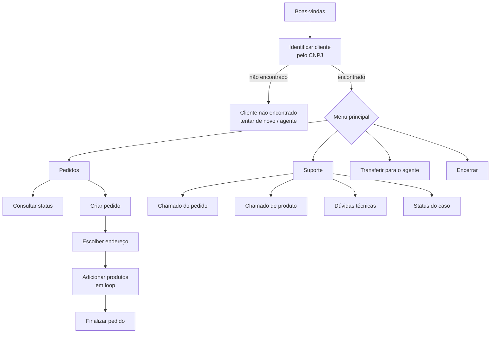

# LDA Alimentos · Service Cloud II
 
### Atendimento omnichannel com chatbot, portal do cliente e direitos Premium no Salesforce
 


 
Case prático do **Programa de Formação de Consultor Funcional** do **Grupo Taak**. Ele dá continuidade aos cases 2 (Sales Cloud) e 3 (Service Cloud I), na mesma org da empresa fictícia **LDA Alimentos**.
 
O objetivo foi evoluir o atendimento criado no case 3. O cliente passou a resolver pedidos e suporte sozinho com a assistente virtual **Lia**, tanto num **portal (Experience Cloud)** quanto no **Facebook Messenger**. Além disso, os clientes **Premium** passaram a receber um nível de serviço diferenciado.
 
> Projeto 100% declarativo (low-code): Flows, Einstein Bot, Omni-Channel, Entitlements, Validation Rules e Experience Builder. Nenhuma linha de Apex.
 
---
 
## Sumário
 
- [O desafio](#o-desafio)
- [Visão geral da solução](#visão-geral-da-solução)
- [1. Chatbot Lia](#1-chatbot-lia)
- [2. Atendimento via Portal e Canal](#2-atendimento-via-portal-e-canal)
- [3. Direitos (Entitlements)](#3-direitos-entitlements)
- [4. Omni-Channel](#4-omni-channel)
- [5. Ajustes pós-Sprint Review](#5-ajustes-pós-sprint-review)
- [Componentes criados](#componentes-criados)
- [Roteiro de teste](#roteiro-de-teste)
- [Desafios e aprendizados](#desafios-e-aprendizados)
- [Melhorias futuras](#melhorias-futuras)
---
 
## O desafio
 
A LDA Alimentos já usava o Service Cloud, com horário comercial, SLA, console e Omni-Channel. O case pediu:
 
| Área | Requisito |
|---|---|
| **Chatbot · Pedido** | Consultar o status de um pedido · Criar um pedido e adicionar itens |
| **Chatbot · Suporte** | Abrir chamado sobre um pedido · Abrir chamado sobre um produto do pedido · Transferir para um agente e direcionar a uma fila |
| **Portal e Canal** | Publicar o bot em uma comunidade Salesforce · Criar uma página no Facebook · Criar um canal de mensagens |
| **Direitos** | Contas Premium recebem os direitos Premium automaticamente · Não é possível atribuir direito Básico a uma conta Premium |
| **Omni-Channel** | Transferir atendimentos para agentes disponíveis · Usar respostas rápidas no chat |
 
**Premissa da liderança:** o bot atende **apenas clientes já cadastrados**.
 
---
 
## Visão geral da solução
 

 
---
 
## 1. Chatbot Lia
 
A **Lia** (Einstein Bot, versão 2) identifica o cliente e conversa com o Salesforce por meio de **Flows autolaunched**. Assim, o bot só enxerga dados do próprio cliente.
 
### Jornada da conversa
 

 
### Flows usados pelo bot
 
| Flow | O que faz |
|---|---|
| **Bot - Identificar Cliente** | Recebe o CNPJ (com ou sem pontuação), padroniza o formato, busca a **Conta** e o **Contato** e devolve os IDs e o nome |
| **Bot - Consultar Status do Pedido** | Busca o pedido pelo número **filtrando pela conta do cliente** (completa os zeros: `105` → `00000105`) |
| **Bot - Iniciar Pedido** | Cria o pedido em rascunho com o **catálogo do tipo de cliente** e o endereço escolhido, e devolve os produtos disponíveis |
| **Bot - Adicionar Item** | Cria o item do pedido com quantidade e preço de tabela |
| **Bot - Listar Produtos do Pedido** | Lista só os produtos de um pedido, para o chamado de produto |
| **Bot - Criar Chamado** | Cria o Case com Conta, Contato, Pedido, Produto e Origem = Chat, e devolve o número |
 
### Destaques
 
- **Segurança:** um pedido de outra conta não é exibido. O bot responde "pedido não encontrado".
- **Pedido com vários itens:** o cliente adiciona quantos produtos quiser antes de finalizar.
- **Escolhas dinâmicas:** produtos e itens aparecem como botões vindos do Salesforce (*Dynamic Choices*).
- **Mensagens de erro e de "sem agente disponível"** traduzidas e tratadas.
---
 
## 2. Atendimento via Portal e Canal
 
| Item | Configuração |
|---|---|
| **Portal LDA** | Site Experience Cloud (template *Customer Service*), ativo, com acesso público para visitantes e textos personalizados para a LDA |
| **Chat no portal** | Componente **Embedded Messaging** com o deployment **Chat LDA Portal** (Messaging for In-App and Web / Enhanced Chat) |
| **Facebook** | Página **LDA Alimentos** + canal de mensagens Enhanced do Facebook Messenger |
| **Roteamento** | Os dois canais usam o Omni-Channel Flow **Route to Lia**, com fila de fallback **Atendimento LDA** |
| **Segurança do site** | Relaxed CSP, Trusted Site do servidor de mensagens, CORS e Trusted URL do domínio do portal |
| **Console** | Componente *Enhanced Conversation* na página da Messaging Session |
 
---
 
## 3. Direitos (Entitlements)
 
Dois processos de direito, com marcos contados no **horário comercial da LDA**:
 
| Marco | Critério | Básico | Premium |
|---|---|---|---|
| Primeira Resposta | Status = New | 1h | **30 min** |
| Tratativa | Status = Working | 6h | **3h** |
| Resposta do Cliente | Status = Waiting on Customer | 8h | 8h |
| Finalização do Chamado | Case aberto | 8h | **4h** |
 
### Automação e regras
 
- **Campo `Tipo de Conta`** (Premium / Básico) na Account e **tipo** no Entitlement.
- **Flow `Conta Premium - Criar Direito Premium`** (record-triggered): quando a conta vira Premium, cria o direito **Suporte Premium LDA** e **encerra o direito Básico** ativo.
- **Validation Rule `Bloquear_Basico_em_Conta_Premium`**: impede atribuir um direito Básico a uma conta Premium.
```text
AND(
  ISPICKVAL(Account.Tipo_de_Conta__c, "Premium"),
  ISPICKVAL(Type, "Básico"),
  OR(ISNEW(), ISCHANGED(Type), ISCHANGED(AccountId))
)
```
 
---
 
## 4. Omni-Channel
 
- **Fila Atendimento LDA** (Case e Messaging Session), com roteamento *Most Available*.
- **Presence Configuration** com transferência habilitada e **Skills-Based / Direct-to-Agent Routing**, para transferir a conversa **direto para um agente específico (Reps)**.
- Licenças **Messaging User** e **Enhanced Chat User**, e as permissões **Messaging Agent** e **Enhanced Chat Rep**, no permission set dos agentes.
- **Respostas rápidas (Quick Text)** com merge fields, disponíveis no canal Messaging:
| Quick Text | Uso |
|---|---|
| Saudação | "Olá! Meu nome é `{!User.FirstName}`…" |
| Número do pedido | Pede o número do pedido ao cliente |
| Transferência | Avisa sobre a transferência |
| Encerramento | Fecha o atendimento |
 
---
 
## 5. Ajustes pós-Sprint Review
 
Na primeira apresentação, o gestor apontou melhorias, e todas foram implementadas:
 
| Apontamento | Solução |
|---|---|
| Conta Premium não pode voltar para Básico, porque isso gera perda de receita | Validation Rule `Bloquear_Premium_para_Basico` com `PRIORVALUE` |
| A transferência ia para a fila, e não para um agente específico | Roteamento direto para agente + licenças e permissões de Messaging, e transferência pela aba **Reps** |
| O chat estava no site técnico do deployment, e não numa comunidade | Criação do **Portal LDA** no Experience Cloud, com o chat incorporado |
| O bot identificava o cliente pelo e-mail | Identificação pelo **CNPJ**, aceitando o número com ou sem pontuação |
| O campo Produto do chamado mostrava um ID | Novo campo **lookup `Produto do Pedido`** (Case → Product), pesquisável |
| O endereço do pedido era sempre o da conta | O cliente escolhe **endereço da conta, do contato ou um novo**, informado no chat |
 
```text
// Bloquear_Premium_para_Basico (Account)
AND(
  ISCHANGED(Tipo_de_Conta__c),
  ISPICKVAL(PRIORVALUE(Tipo_de_Conta__c), "Premium"),
  NOT(ISPICKVAL(Tipo_de_Conta__c, "Premium"))
)
```
 
O **layout do Case** também foi reorganizado em seções (Chamado, Cliente, Pedido e Produto, Descrição, SLA e Sistema), e os campos de exemplo foram removidos.
 
---
 
## Componentes criados
 
<details>
<summary><b>Objetos e campos</b></summary>
| Objeto | Componente |
|---|---|
| Account | `Tipo_de_Conta__c` (picklist) · Validation Rule `Bloquear_Premium_para_Basico` |
| Entitlement | Valores de tipo Premium / Básico · Validation Rule `Bloquear_Basico_em_Conta_Premium` |
| Case | `Pedido__c` (lookup Order) · `Produto_do_Pedido__c` (lookup Product) · Origem "Chat" · layout reorganizado |
| Order | Campos de endereço de destino usados pelo bot (rua, número, bairro, cidade, estado, complemento) |
 
</details>
<details>
<summary><b>Automação</b></summary>
| Tipo | Nome |
|---|---|
| Record-Triggered Flow | Conta Premium - Criar Direito Premium |
| Autolaunched Flow | Bot - Identificar Cliente |
| Autolaunched Flow | Bot - Consultar Status do Pedido |
| Autolaunched Flow | Bot - Iniciar Pedido |
| Autolaunched Flow | Bot - Adicionar Item |
| Autolaunched Flow | Bot - Listar Produtos do Pedido |
| Autolaunched Flow | Bot - Criar Chamado |
| Omni-Channel Flow | Route to Lia |
 
</details>
<details>
<summary><b>Service Cloud</b></summary>
| Área | Componente |
|---|---|
| Einstein Bot | Lia (Version 2), com diálogos de Pedidos, Suporte, Novo Endereço e Transferência |
| Entitlements | Processo LDA Alimentos (Básico) · Processo Premium LDA Alimentos |
| Omni-Channel | Fila Atendimento LDA · Presença LDA · Routing Configuration · Permission set dos agentes |
| Quick Text | Saudação · Número do pedido · Transferência · Encerramento |
| Messaging | Canal web Chat LDA · Canal Facebook LDA Alimentos |
| Embedded Service | Deployments Chat LDA Web e Chat LDA Portal |
| Experience Cloud | Portal LDA (Customer Service) |
 
</details>
---
 
## Roteiro de teste
 
1. Abra o **Portal LDA** numa janela anônima → clique no balão do chat.
2. Informe o **CNPJ** de um cliente cadastrado. A Lia cumprimenta e mostra o menu.
3. **Pedidos → Consultar status** com um pedido do cliente. Depois tente um pedido de outro cliente: ele não é exibido.
4. **Pedidos → Criar pedido** → escolha o endereço → adicione dois produtos → finalize.
5. **Suporte → Chamado de produto** → escolha o pedido e o produto. O Case é criado com o lookup preenchido.
6. **Transferir para o agente** → o agente aceita no console → usa um **Quick Text** → transfere em **Reps** para outro agente.
7. Mude uma conta para **Premium**. O direito Premium aparece sozinho. Tentar voltar para Básico, ou incluir um direito Básico, mostra erro.
8. Repita o `Olá` pelo **Messenger** da página LDA Alimentos.
---
 
## Desafios e aprendizados
 
- **Transferência que não funcionava:** a fila de fallback do *Route to Lia* estava como `[REPLACE ME]`.
- **Agentes não apareciam em Reps:** era preciso o *Direct-to-Agent Routing* e as licenças de Messaging.
- **Quick Text sem resultados no chat:** as respostas só estavam liberadas para o canal Email.
- **Chat não aparecia para visitantes do portal:** foram necessários CSP, Trusted Sites, CORS e Trusted URL.
- **Erros de Flow:** o e-mail *"An Error Occurred with Your Flow"* mostrava o campo obrigatório que faltava, por exemplo o contato do pedido.
- **Tipos de dados entre bot e Flow:** número precisa ser *Number* nos dois lados, e as escolhas do bot precisam ter o texto idêntico ao do `Decision`.
- **Escopo:** entregar o que o case pede, sem excessos, e registrar as ideias extras como melhorias futuras.
---
 
## Melhorias futuras
 
- Fila **Atendimento Premium** com prioridade maior no Omni-Channel, para o cliente Premium ser atendido antes.
- Limpar as variáveis do bot entre diálogos, para permitir vários chamados na mesma conversa.
- Tratar no bot o caso de **conta sem contato cadastrado**.
- Traduzir os componentes padrão restantes do portal.
---
 
## Autora
 
**Maria Eduarda Cortellini**, estagiária de consultoria Salesforce e estudante de Ciência da Computação.
 
> Projeto educacional. A LDA Alimentos é uma empresa fictícia, e todos os dados usados nos testes são fictícios.
 
